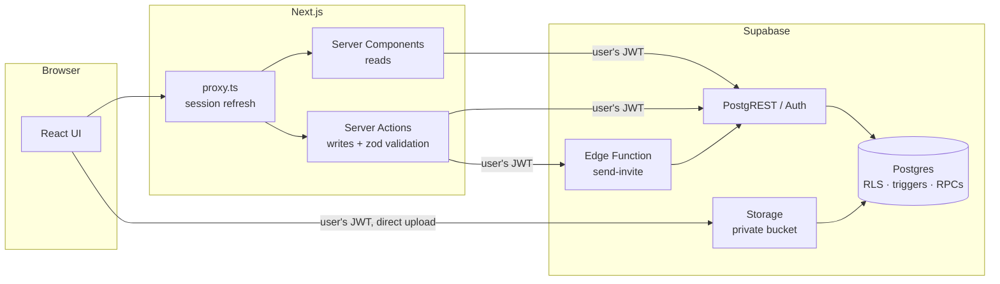
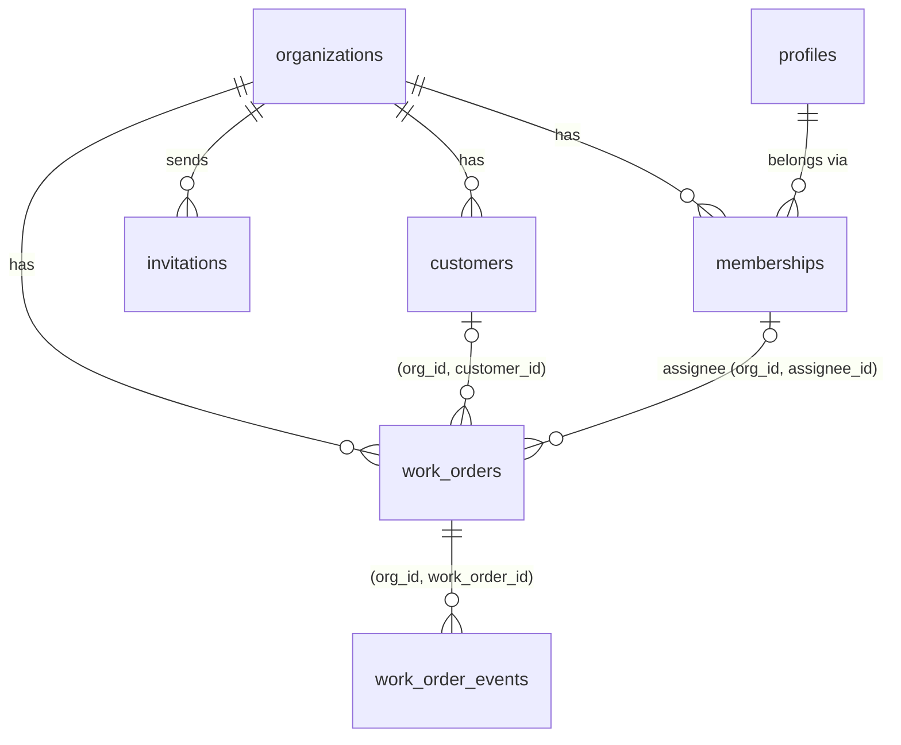

# Munkalap

A small multi-tenant work order tracker for service businesses (bike shops, appliance repair, HVAC): customers, jobs from intake to done, a team with roles, attachments, and a full activity history.

*Munkalap* is Hungarian for "work sheet", the paper form a repair shop fills out for every job.

**Stack:** Next.js 16 (App Router, Server Components, Server Actions) · TypeScript · Tailwind CSS 4 · Supabase (Postgres, Auth, Storage, Edge Functions, Row Level Security) · zod · Vitest · pgTAP

The interesting part of this project isn't the UI. It's **where each rule lives and how it's proven**. The data model, the RLS policies and the database tests are the core; [docs/architecture.md](docs/architecture.md) explains every decision and its trade-offs.

## Features

- **Organizations** with owners and members. Invite people by email; they join when they sign in with that address.
- **Work orders** with per-organization numbers (#1, #2, …), status, priority, assignee, due date and customer. Filter by open/closed/mine, or search by title or `#number`.
- **Activity log** on every work order: status changes and assignments are recorded by the database, and the team can add comments.
- **Attachments** (photos, PDFs) uploaded straight from the browser to private Supabase Storage, downloaded through short-lived signed links.
- **Customers** with their full job history. A customer with work orders can't be deleted, because that history is a business record.

## Architecture



Every arrow into Supabase carries **the signed-in user's JWT**. There's no service role key anywhere in the app, so Postgres applies the same Row Level Security whether the request comes from a page, a Server Action, the browser uploading a file, or the Edge Function.

### Data model



Child rows reference parents on **`(org_id, id)`**, so the database guarantees a work order can't point at another organization's customer, or be assigned to someone outside the org.

### Where each rule lives

| Rule | Enforced by |
|---|---|
| You only see your organizations' data | RLS policies (`org_id in (select private.my_org_ids())`) |
| Only owners invite, change roles, delete | RLS policies using `private.my_owned_org_ids()` |
| A work order can't move to another org, or get a client-chosen number | Column-level `GRANT`s (RLS can't restrict columns) |
| Customer and assignee belong to the same org | Composite foreign keys |
| Numbers are sequential per org, even under concurrency | `BEFORE INSERT` trigger with a row lock |
| History can't be forged or skipped | `AFTER` trigger writes events; table is append-only |
| An org always has an owner | `BEFORE UPDATE/DELETE` trigger on `memberships` |
| Invitations only work for the confirmed, matching email | `accept_invitation()` RPC |
| Files are only reachable inside your org's work orders | Storage policies on the `{org_id}/{work_order_id}/` path |
| Input has the right shape | zod in Server Actions (UX and clear errors, not security) |

## Running it locally

Requirements: Node 22+, Docker, and the [Supabase CLI](https://supabase.com/docs/guides/local-development/cli/getting-started).

```bash
npm install
```

```bash
supabase start
```

This starts Postgres, Auth, Storage and the Edge Runtime in Docker, applies the migrations, and loads [supabase/seed.sql](supabase/seed.sql). Then copy `.env.example` to `.env.local` and fill it in from `supabase status`:

```bash
cp .env.example .env.local
```

```bash
npm run dev
```

Open http://localhost:3000 and sign in with a demo account (password `password123`):

| Account | Role |
|---|---|
| `anna@demo.test` | Owner, Kovács Bike Service |
| `bence@demo.test` | Member, Kovács Bike Service |
| `dora@demo.test` | Owner, Nagy Appliance Repair, with a pending invitation to Kovács |

Signing in as Anna and Dóra in two browsers shows tenant isolation in action.

**Invitation emails.** Without an email provider, the team page shows a link to copy. To send real emails, put a [Resend](https://resend.com) key in `supabase/functions/.env` (see `.env.example` there).

## Tests

```bash
npm run db:test
```

Runs the [pgTAP tests](supabase/tests/database/) against the local database (70 assertions). They act as real users, the same way PostgREST does, and try to break every rule above: reading another org's data, attaching another org's customer, moving a work order between orgs, forging a comment's author, removing the last owner, accepting someone else's invitation, and so on.

```bash
npm test
```

Runs unit tests for the pure logic: filter parsing, search escaping, file name sanitizing (Hungarian accents included), the redirect guard, time zones, and error messages.

CI ([.github/workflows/ci.yml](.github/workflows/ci.yml)) runs lint, typecheck, unit tests and the build, then starts a fresh database, runs the pgTAP suite, and **fails if `lib/database.types.ts` doesn't match the schema**. After changing a migration, regenerate the types:

```bash
npm run db:types
```

## Project structure

```
app/                     Routes. Pages are Server Components; actions.ts files hold Server Actions.
  o/[orgId]/             Everything inside an organization (work orders, customers, team)
components/              UI. Client Components are marked 'use client'.
lib/
  data.ts                All reads (server-only), one function per query
  validation.ts          zod schemas for everything a client can send
  supabase/              Server, browser and proxy clients
  database.types.ts      Generated from the schema; don't edit by hand
supabase/
  migrations/            Schema → functions & triggers → RLS & grants → storage
  tests/database/        pgTAP tests for tenant isolation, roles and workflows
  functions/send-invite/ Edge Function that emails invitations
  seed.sql               Demo data for local development
docs/architecture.md     Decisions, alternatives and trade-offs
```

## Deploying

1. Create a Supabase project, then run `supabase link` and `supabase db push`.
2. Deploy the Edge Function and its secrets: `supabase functions deploy send-invite` and `supabase secrets set RESEND_API_KEY=... SITE_URL=...`.
3. In Auth settings, **turn email confirmations on** (invitations rely on confirmed emails) and add `https://your-domain/auth/callback` to the redirect URLs.
4. Deploy the Next.js app to Vercel, or to Cloudflare Workers with [OpenNext](https://opennext.js.org/cloudflare), with `NEXT_PUBLIC_SUPABASE_URL` and `NEXT_PUBLIC_SUPABASE_PUBLISHABLE_KEY` set.

## What I'd build next

- **Realtime updates** on the work order list (Supabase Realtime respects RLS).
- **Hungarian UI.** All copy is in a few components, ready to move into message files.
- **Time zone per organization**, instead of the app-wide `Europe/Budapest`.
- **Pagination and trigram search** (`pg_trgm`) once a shop has thousands of work orders. The list currently shows the latest 200.
- **End-to-end tests** with Playwright for the main flows (sign up → create org → invite → accept).
- **Rate limiting** on invitations and sign-ups.
